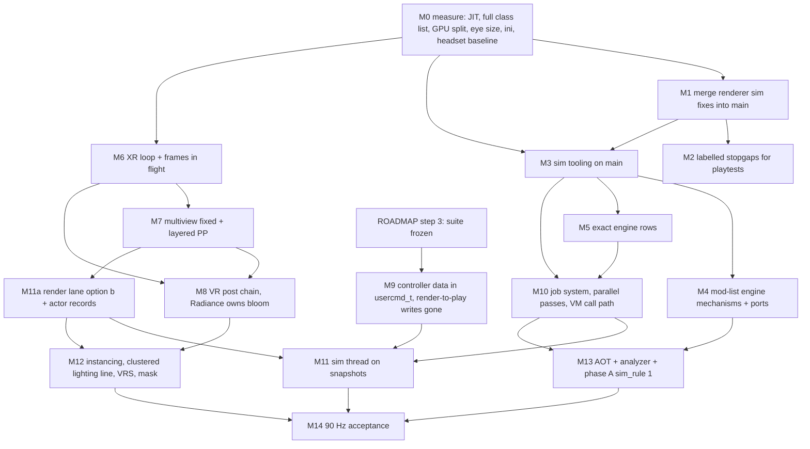

# The 90 Hz gameplan for UZDXREMA with the owner's mod list

Date 2026-11-13. Engine of record [F] `main` @ e84623f; render lane [FR] `renderer` @ abb19af; stock [U] UZDoom 5.0.0.
Inputs: the seven fork-delta reports `work/fork/A_sim.md` [A], `B_modlist.md` [B], `C_frame_xr.md` [C],
`D_vulkan_gpu.md` [D], `E_render_lane.md` [E], `F_monster_stack.md` [Fm], `G_use_the_machine.md` [G]; the owner's
measurements `10_MEASUREMENTS.md` [M]; `OWNER_DECISIONS.md` (binding); `CLAUDE.md`, `ROADMAP.md`. Row IDs in brackets
(e.g. [A P9.9]) point at the report row; the implementer's checklist is `31_FORK_DELTA_CHECKLIST.md`.

Conventions. Every number not taken from [M] is **Inference** and shows its derivation. Projections have three columns:
**pess** (every unknown lands badly), **med** (the reports' middle values), **opt** (every unknown lands well). "Tic"
means one 35 Hz playsim tic (28.57 ms budget); "frame" means one 11.11 ms headset frame at 90 Hz. Code citations were
re-read for this plan where they carry a number or a decision (marked "re-read"): `r_ticstability` spin and default
([F] src/d_net.cpp:2251-2284, re-read), `WorldStateHash` ([F] d_net.cpp:1235-1256, 1291, re-read),
`vr_openxr_multiview` default false ([F] src/common/rendering/hwrenderer/data/hw_vrmodes.cpp:643, re-read), PP pass key
`ViewMask = 0` ([F] src/common/rendering/vulkan/renderer/vk_pprenderstate.cpp:112, 159, re-read), the full GPU wait
per frame ([F] src/common/rendering/vulkan/system/vk_renderdevice.cpp:731-750, re-read), the 1 ms poll sleep
([F] vk_commandbuffer.cpp:181-221, re-read), gameplay eyes at the runtime's recommended size
([F] vk_renderdevice.cpp:1467-1478 + vk_openxrdevice.cpp:2191-2196, re-read), controller publish to the pawn
([F] vk_openxrdevice.cpp:4802-4852 and hw_vrmodes.cpp:1504-1556, re-read), `profilethinkers` clocking only `CallTick`
([F] src/playsim/dthinker.cpp:1021-1044, re-read), the default thinker iterator starting at statnum 32
([F] dthinker.cpp:1617-1629, statnums.h:42, re-read), `ChangeSoundPitch` walking every channel on main
([F] src/common/audio/sound/s_sound.cpp:1073-1085, re-read) and `sim_maxcatchup` existing only on [FR]
([FR] src/d_net.cpp:207, 2413-2416, re-read), champion colour weights ([MOD] 2.2-Enemies-mk-champions/cvarinfo.txt,
re-read: 14 colours at 10, Bronze 3, Silver 2, Gold 1 = 146).

---

## 1. Lead: the verdict

**Verdict.** 90 Hz on this mod list needs three structural changes, all of them:

1. **The sim on its own thread, off the headset frame.** Without it, every 90 Hz frame that carries a tic must fit
   tic + render in 11.1 ms, which leaves ≈5 ms for the tic. Today's tic is ≈160 ms, 30× too slow.
2. **The 4-player tic cut from ≈160 ms to ≤ 20 ms median.** The order is: first, engine mechanisms that stop the
   mod list from spawning helper actors (Phase 10: overlays, parked inventory, native pitch/tic scale, spawn-event
   filters, client-side effects); then exact engine rows (dense actor array, word-wise hash, call path); then the
   use-the-whole-machine track (job system, AOT script, deterministic parallel thinkers under `sim_rule 1`).
3. **A GPU frame built for VR**: frames in flight; multiview fixed, with culling from both eyes and post-processing
   once for both eyes; a post chain sized for VR in which Radiance owns bloom and BloomBoost is retired; clustered
   engine-native lighting on a 1.8 ms line; fixed foveated shading; the visibility mask. All of it runs at the
   headset's native resolution. Dynamic resolution is not used anywhere.

**The honest gap.** The render-thread CPU closes: median ≈4.0 ms against a 6 ms budget. The sim and the GPU do
**not** close at the median of today's unknowns:

- **Sim: ≈33.5 ms standing tic (target 20).** [M] lists only ≈52 ms of the 130.8 ms of thinker time by class; ≈78 ms
  is unattributed. The sim gets to ≈20 ms only if the first measurement finds ≥ 30 ms of that tail to be removable
  helper/handler work (→ ≈19.8). Two other routes also reach it: ≥ 20 ms of removable tail plus a parallel fraction
  p ≥ 0.7 and an AOT speed-up k ≥ 2.2 (→ ≈19.2), or the owner opting into Tick LOD (D9). Parallelism and AOT on
  their own do not close it, even at the top of their modelled ranges (p 0.8, k 2.5 → ≈22 ms). The pessimistic case
  (≈65 ms) does not close with any engine lever in the reports.
- **GPU: ≈10.9 ms of app GPU at Index-class pixel counts (target 9.0 including 1.2 ms spare, so ≤ 7.8 ms of
  work).** [M] does not attribute ≈12 ms of today's GPU time. At Index-class pixels the GPU closes only if that
  ≈12 ms turns out to have a structural fix (C1, → ≈8.2) and Hi-Z visibility also lands (C2). At Quest-class pixels
  C1 alone is enough.

Neither unattributed number has been measured. Each is plausible from the code. Both come from zero-build runs
(M0-2, M0-4), which is why the plan starts with M0.

**Order.** Two weeks of zero-build measurement and read-only tooling. Then merge the render branch's sim fixes into
`main`. Then four lanes in parallel (sim, mod-list, frame/XR, render/GPU). Then move controller data into `usercmd_t`
and remove the render→play writes, which together make the sim thread safe. Then the sim thread. Then AOT and
parallel thinkers. The owner must give the go-ahead before several of these start (§7): D1 (a sim lane on `main`),
D2 (the merge), D3 (`sim_rule 1`), D4 (render-lane order), D11 (avatar-lane rules), D12 (AOT toolchain) and D16
(render-lane backend items onto `main`). At one person-equivalent per lane, M14 is ≈16-22 months away (§9).

---

## 2. The budget: one headset frame at 90 Hz (11.11 ms)

### 2.1 The table

| Line | Today (owner's PC, modlist, Sunder MAP15 start) | Target | Plan projection pess / med / opt | Derivation | Report rows |
|---|---|---|---|---|---|
| **Sim thread** (one tic, on its own core; 4-player) | ≈160 ms/tic (SP ≈150) on the main thread, inside the frame; [M] flat run 1.73 tics/frame → 315 ms frames | median ≤ 20 ms, p95 ≤ 28.6 ms, standing and in a sustained fight | standing **65.1 / 33.5 / 12.7**; fight +2 to +4 | §3 waterfall: 144.7 P_Ticker [M] §2 + 5.5 client-side logic ([A] B.2, [FR] SIM_AT_MOD_SCALE §1) + 8-12 netgame hash ([A] F-SIM-4) | [A] "90 Hz contribution"; [B] "90 Hz"; [Fm] B.4; [G] "Combined projection" |
| **Render-thread CPU** per frame (no tic) | ≈16 ms (13-20): 2 × 4.35-6.5 scene builds (non-multiview), 2-4 ms polled-wait overshoot, 2 SetUps, ≈2.3 other | ≤ 6 ms (hard cap 7) | map start **7.3 / 4.0 / 2.2** (§5.2 R7); fight ≈ **9 / 5.5-6 / 4** | §5 waterfall | [C] C.1; [D] "CPU submission budget"; [E] §4, "90 Hz contribution" |
| *of which* **XR loop overhead** (poll, sync, locate, waits, mirror). Part of the render-CPU line above, **not additive** | no-mod: 5-8 ms (spin 2.7-3.2 avg, polled waits 2-4, double SetUp 0.1-0.5). Modlist: the spin is 0 today because every frame owes tics ([C] P0-F12); the waits and SetUp are the same ms already counted in the line above | ≤ 0.6 ms (inside the ≤ 6) | **0.8 / 0.5 / 0.4** | [C] C.2 first bullet; [C] C.1 budget (XR 0.3 + latch/submit 0.3) | [C] P0-F12, P2-9a/b/d, F-XR-1/2 |
| **GPU** (app, both eyes, native recommended size, no dynamic res) | ≈47 ms at S = 1.75 (Index-class 9.0 MP); ≈43 at S = 1.55 (Quest 3 class); ≈39 at S = 1.36 (Quest 2 class) | ≤ 9.0 ms incl. 1.2 ms spare (work ≤ 7.8) | S = 1.75: **18.5 / 10.9 / 7.6**; S = 1.55: 16.8 / 9.9 / 7.0; S = 1.36: 15.2 / 9.1 / 6.4 | §4 waterfall | [D] "GPU budget per pass"; [E] §5 |
| **Compositor margin** | unmeasured (`XrCompGpu`, `XrCompCpu` exist: [F] hw_perftrack.cpp:119-122) | ≥ 1.5-2.0 ms of GPU and CPU left to the runtime | = 11.1 − app GPU | runtime time (VDXR/SteamVR encode, reprojection) is outside the app's control | [D] header |
| **Memory** (16 GB shared with OS, runtime, mods) | unmeasured (no memory column in perf_track: [F] hw_perftrack.cpp has none, grep) | no paging during a 10-minute headset run; plan additions declared | plan adds **≈ +0.35-0.53 GB host, +0.17-0.32 GB VRAM** (§2.3) | ledger §2.3 | [G] §5; [E] F-RL-6; [D] F-GPU-9 |

### 2.2 How the lines relate (Inference)

- **Why a sim thread is not optional.** 35 tics/s over 90 frames/s puts a tic in 38.9 % of frames. Without a sim
  thread every such frame needs tic + render CPU + XR ≤ 11.1 ms, i.e. a tic ≤ ≈5 ms after a 4.4 ms scene build and
  1.5 ms of submit/XR ([A] "Without a sim thread"). Today's 150-160 ms is 30× that; even the no-mod tic is 4.5 ms
  ([M] rr344). With a sim thread the tic has its own 28.57 ms slot ([C] P8-3). So the sim line above is a separate core,
  not a share of the 11.1 ms.
- **Why median 20 and p95 28.6.** Above 28.6 ms the game slows, and in a netgame every peer waits for the slowest
  ([A] "Budget with a sim thread"). 20 ms median leaves ≈8 ms for spikes (Pink-champion scans, spawn bursts, GC).
- **Why the render line is CPU-only.** With frames in flight ([D] P1.1) a frame costs max(CPU, GPU), not the sum
  ([C] P2-10b). Today it is the sum plus 1 ms poll quanta ([F] vk_commandbuffer.cpp:219, re-read).
- **Pixel scale S.** The owner's headset is not recorded in the repo (searched handoffs and docs; only "Reverb and
  Oculus Quest via Virtual Desktop" in docs/FEATURES.md:229). Gameplay eyes are rendered at the runtime's recommended
  size × `vr_openxr_render_scale` (default 1.0, hw_vrmodes.cpp:649; re-read at vk_renderdevice.cpp:1467-1478). [D]
  uses S = 1.75 (Index 2016×2240 ×2 = 9.03 MP over the 5.16 MP flat window), [C]/[E] 1.36 (Quest 2 over VD). This plan
  keeps S = 1.75 as the planning case and shows 1.55 and 1.36; run M0-3 replaces it with the logged value
  (`OpenXR: view %u recommended`, vk_openxrdevice.cpp:2888, re-read). **Open risk:** the Reverb named in
  FEATURES.md may recommend more pixels than an Index. Then S > 1.75 and every fragment row grows with it (R11).

### 2.3 Memory ledger (owner decision 8: every design that adds memory states it)

| Item | Adds (Inference) | Where | Source |
|---|---|---|---|
| Frames in flight N = 2: second copy of every per-frame host-visible buffer (stream 300 × 64 KB = 19 MB, matrices, light, bone, viewpoint buffers, the fork's 8 buffers, compute host lists) and a second query pool | +40-120 MB host-visible | host / BAR | [D] P1.1, P1.2, F-GPU-8 |
| Stream-wall stopgap (1,000 blocks, system memory, not BAR) | +64 MB until P1.4 lands, then 0 | host | [D] F-GPU-9 |
| Dense actor index (0.4 MB), phase-A snapshot (4-20 MB), position mirror (1.3 MB), per-tx state (chunked to 12 MB), per-thread scratch (16 MB), slabs (16-32 MB) | +50-82 MB (the items summed; [G]'s "50-120" total also contains the AOT row below) | host | [G] §5 |
| Render snapshot (312 B × 53k × 2) | +33 MB | host | [FR] r_snapshot.h; [G] §5 |
| AOT DLL replaces JIT image | 0 to +50 MB | host | [G] F-VM-6 |
| Render lane static mesh + kept staging copies | +158-180 MB VRAM, + same in host until staging is freed | VRAM + host | [E] F-RL-6 |
| Clustered light grid (both eyes, one grid), VRS rate image, visibility mask mesh | < 15 MB | VRAM | [D] P6.B, VR9.a/b |
| **Total** | **≈ +0.35-0.53 GB host** (40 + 64 + 50 + 33 + 0 + 158 = 345 MB to 120 + 64 + 82 + 33 + 50 + 180 = 529 MB, staging and stream stopgap included; ≈0.12-0.29 GB once both are gone), **+0.17-0.32 GB VRAM** (158-180 + < 15 MB, plus up to 120 MB if the ringed per-frame buffers live in BAR) (12 GB card) | | |

Mod-list work *removes* memory: ≈30,700 fewer actors × 3,104 B ([A] P9.8 probe) ≈ 95 MB plus their script objects
([B] "Sum"). The one capacity hazard found is not memory but a counter: Universal Entropy's per-actor translations
abort the game after ≈9 Sunder loads in one session ([Fm] F-MON-6; `I_Error` at 65,535 in
[F] src/common/engine/palettecontainer.cpp:273-290).

---

## 3. The sim-tic waterfall: ≈160 ms → target

### 3.1 The baseline, and why `main` is worse than the baseline

**B0 = 160.4 ms per tic**, 4-player, owner set, Sunder MAP15 start, player standing, renderer-build sound code:

| Component | ms/tic | Source |
|---|---|---|
| `RunThinkers` (thinkers) | 130.80 | [M] §2 rr347 |
| interpolation reset walk | 9.02 | [M] §2 |
| `WorldTick` handlers | 4.07 | [M] §2 |
| particles/beams | 0.72 | [M] §2 |
| player think ×4 + prediction | ≈0.3 | [M] 0.07 for one flat player; [A] F-SIM-7 ≤0.5 for 4 VR players (Inference) |
| client-side logic per tic (recreate-lights walk, client thinkers, `FDynamicLight::Tick`) | ≈5.5 | [FR] SIM_AT_MOD_SCALE.md §1 at 39.5k thinkers (a lead); [A] B.2 |
| netgame `WorldStateHash`: byte-wise FNV, 72 B/actor, every tic ([F] d_net.cpp:1235-1256, re-read) | ≈10 (8-12) | [A] F-SIM-4: 53,116 × 150-230 ns (Inference) |
| **B0** | **≈160.4** | single player ≈150 (no hash; one player) |

**`main` today is worse than B0.** [M] was measured on `doomxr_rend1113a.exe` (renderer branch). `main` lacks the
per-source sound index: `ChangeSoundPitch` walks every channel ([F] s_sound.cpp:1073-1085, re-read) against the
indexed walk on [FR] (s_sound.cpp:1089-1102). Universal Entropy's 7,686 `Shifter`s call it twice a tic each ([Fm] B.3).
The render lane measured the main-equivalent at 174 ms/tic for 4,752 Shifters on Abandon MAP13; scaled to 7,686 that
is ≈280 ms on Sunder (Inference, [Fm] F-MON-5). `main` also lacks the catch-up cap ([FR] d_net.cpp:2415-2416 only), so
a 150 ms tic runs 5+ owed tics the next frame and spirals ([A] F-SIM-1). **Step W0 (merge) is therefore a
precondition, not a saving.** Every later number assumes it. **Open risk:** the cap applies to single player only
(`if (!netgame && sim_maxcatchup > 0 ...)`, [FR] d_net.cpp:2415, re-read). In a 4-player game nothing bounds the
owed tics, so until the tic fits, a netgame shows the slow tic as lockstep slowdown and catch-up bursts. W0 does not
protect the netgame case, and M1's `Tics ≤ 2` gate is a single-player gate.

### 3.2 Rules used to avoid double counting between [A], [B], [Fm] and [G]

1. **One owner per millisecond.** Each ms of B0 is assigned to the first step in build order that removes it. Later
   steps operate only on what is left, component by component (thinkers, reset, `WorldTick`, client logic, hash,
   particles).
2. **Removing an actor removes its shares.** A helper removed by the mod-list track also leaves the reset (0.17 µs
   each = 9.02 ms / 53,116, [B] header), the hash (only if it is sector-linked: `WorldStateHash` skips
   `MF_NOSECTOR`, i.e. owned inventory, [F] d_net.cpp:1248 re-read) and the client-side light walk. Those shares are
   booked to the mod-list step, so [A]'s reset/hash/light rows are applied to the *smaller* population.
3. **Parked actors are invisible to the walks.** The default thinker iterator starts at `STAT_FIRST_THINKING` = 32
   ([F] dthinker.cpp:1617-1629, statnums.h:42, re-read), so bars parked at 26/27 and inventory parked at 25 leave the
   reset and the hash, not only `RunThinkers` ([B] P10-R1, F-MOD-8).
4. **[A] P9.1c (native owned-inventory tick) and [B] F-MOD-8 (park no-op owned inventory) overlap**: F-MOD-8 is booked
   in the mod-list step, P9.1c gets only the remainder (0-0.5 ms).
5. **[G] option (d) (parallel helpers) and Phase 10 overlap**: Phase 10 removes the helpers first, so [G]'s parallel
   fraction p is applied to what remains, which is mostly monsters and the unknown tail. That is why this plan's p
   range (0.2 / 0.5 / 0.8) is *lower* than [G]'s (0.30 / 0.60 / 0.85).
6. **[G] F-VM-5 is [A] P0-F1/P9.1b**: booked once, in W2.
7. **[A] P9.3 Tick LOD is not in the base waterfall.** It changes gameplay by design ([A] header) and needs an owner
   decision (§7 D9). It is listed as a closer in §3.5.
8. **The unattributed ≈78 ms** (130.8 − 52.5 listed, over ≈17,400 unlisted thinkers, [A] B.3) is split three ways and
   each part is counted once: (a) the ≈1,400 champion controllers [M] does not list ([B] §2.3: 1,646 icons = 1,646
   champions [M] §3; 245 listed; the code's weights make Cyan 10/146 of them) at an unknown base cost, booked to the
   mod-list step as 10 / 20 / 30 ms; (b) profiler overhead and spawn events at a standing start (≈3-7 ms, [Fm] B.2),
   which do not change the real tic; (c) the residual tail, ≈41-65 ms (78.3 − 30 − 7 to 78.3 − 10 − 3; ≈53 med),
   which only the structural steps touch until M0-2 names it.
9. **A W2 row whose [A] derivation rests on helpers removed at W1 is resized.** [A] P9.4 (BSP point grid, 0.5-3 ms)
   is derived from "3,622 bars + parts + moving monsters ≈ 5-10k relinks" ([A] P9.4; bars `SetOrigin` most tics).
   W1 parks the bars, and at a standing start few monsters relink, so W2 books the grid at 0.05 / 0.25 / 0.5 ms,
   not 0.3 / 1.15 / 2. The rest of the grid's value shows in fights (§3.4).

### 3.3 The waterfall (standing, 4-player)

Tic after each step, **pess / med / opt** (ms/tic). Step order = build order (§6.3).

| Step | What lands | Derivation (Inference) | Tic after |
|---|---|---|---|
| W−1 | `main` today | B0 + Shifter on O(channels) ≈ +280 + catch-up spiral | **≫ 160** (≈440, frames of seconds) |
| **W0** | Merge [FR]'s sim fixes into `main`: `sim_maxcatchup` (cfaf6ac), per-source sound index (7227983, 4e3dd1c, 8b83162), eviction budget (0c8cce3, b78f9c2, 2cd754d), `ticprofile`/`simprofile` (fixed) ([F] HANDOFF_NETPLAY_2026-11-11.md §2 item 1) | restores B0 | **160.4 / 160.4 / 160.4** |
| **W1** | Mod-list track ([B], [Fm]): engine mechanisms (overlays P10.1, attachments P10.2, parked owned inventory F-MOD-8, native pitch/tic scale F-MOD-9/F-MON-4, per-class lists P10.5, `EventHandler.Find` map F-MOD-6, spawn-event filters F-MON-1, client-side promotion F-MON-2) plus the ports onto them (RSQTHP P10-R1→R2, champions, crits, UE, UA compat copies) | thinkers: listed families −41 / −44.8 / −47 (bar 16.46→0.1; icon 4.79; leaves 2.18; Cyan/Silver thrust 8.69→1.5; aggro 4.3→0.4; crit `DoEffect` inside LoB monsters −2.5/−4/−5.4; crit items 1.57; Shifter 2.23; `IA_Sound` 0.89; DarkRed 2.11→0.5) and unlisted controllers −10 / −20 / −30 (≈1,400 × 7 / 14 / 21 µs, [B] §2.3 DarkRed 20.7 µs as the upper base). Reset −5.2 (30,700 actors × 0.17 µs, [B] "Sum"). Hash −1.5 / −1.8 / −2.0 (≈9.8k sector-linked actors of 53k). Client light walk −1.5 / −2.0 / −2.3 (same share of ≈4 ms). `WorldTick` −0.5 / −0.8 / −1.0 (RSQTHP's per-tic icon walk, [B] §2.2) | **100.7 / 85.8 / 72.9** |
| **W2** | Exact engine rows ([A]): dense actor array + reset Step A (and Step B via the `Prev`-store codegen hook), light walk on the dense array, word-wise 64-bit hash, `CallTick` shortcut + validate once, `CallAction` copies/thunks, dormancy, BSP point grid, sight stable sort + within-tic cache, portal render-list key; **adds** the render snapshot write (1.0) and a GC step (0.3) on the sim thread | reset 3.8 ÷ 3-4 → 1.27 / 1.09 / 0.95; client −0.8 / −1.0 / −1.3; hash → 2.0 / 1.7 / 1.4 (5× cheaper per actor, [A] F-SIM-4); thinkers −2.25 / −5.65 / −10.2 (P0-F4 0.2-0.7, P0-F1+P9.1b 0.3-2, P9.1c 0-0.5, F2 0.2-0.5, dormancy 1-3, BSP grid 0.05-0.5 after W1 (§3.2 rule 9), sight 0.5-3; each already scaled to ≈22k actors; med is below the 6.2 midpoint) | **89.9 / 71.2 / 53.2** |
| **W3** | [G] F-MT-1 groundwork, F-MT-2 job system, F-MT-3 engine passes on the pool, F-DOD-1 hot prefix | reset → 0.4 / 0.3 / 0.3; hash → 0.55 / 0.45 / 0.35; client → 1.2 / 0.9 / 0.7; particles 0.72 → 0.25; snapshot write split → 0.4 / 0.35 / 0.25 (E ≈ 4-5 on latency-bound walks, [G] §1.2) | **84.5 / 66.5 / 49.1** |
| **W4** | [G] F-VM-1..4, F-VM-7: per-class tick entry, direct native entries, closed-world devirtualisation, light prologue | [G] S3's −5 / −10 / −20 on its 112 ms of thinkers + `WorldTick`, scaled per column to what is left here (81.1 / 63.6 / 46.7 ms): −3.6 / −5.7 / −8.3, split pro rata: −3.46 / −5.39 / −7.78 on thinkers, −0.16 / −0.29 / −0.55 on `WorldTick` | **80.9 / 60.8 / 40.8** |
| **W5** | [G] F-VM-6 AOT of the fixed, versioned mod set (stages 1+2) | saving = T × s × (1 − 1/k) on T = thinkers + `WorldTick` (77.5 / 57.9 / 38.3); (s, k) = (0.35, 1.4) / (0.5, 1.8) / (0.65, 2.5) ([G] §2.5) | **73.2 / 47.9 / 25.8** |
| **W6** | [G] phase A under `sim_rule 1`: analyzer F-MT-9, runtime F-MT-8, rule-D RNG F-MT-7, L helpers F-MT-5, transactional movers F-MT-6 | wall = T(1−p) + T·p·o/E + T·p·c + 0.8; (p, o, E, c) = (0.2, 1.30, 5.5, 0.10) / (0.5, 1.25, 6.0, 0.08) / (0.8, 1.15, 7.5, 0.05) on T = thinkers only (`WorldTick` stays serial) = 66.7 / 42.8 / 21.9 → wall 58.6 / 28.3 / 8.7 | **65.1 / 33.5 / 12.7** |

Components at the end (med): thinkers 28.3, `WorldTick` 2.3, client 0.9, hash 0.45, snapshot 0.35, GC 0.3, player
0.3, reset 0.3, particles 0.25 (= 33.5).

**Reading.** The base plan removes 59 % (pess), 79 % (med) or 92 % (opt) of the tic. The mod-list track is the
largest single step (−60 to −88 ms) and the cheapest. The structural track then takes the median from 86 to 33.5 ms
(2.6×). [A]'s "10-20 %" is the W2 row alone. [G]'s "≈56 ms median" is W2-W6 without W1; its S6 adds Phase 10 *and*
opt-in Tick LOD and lands at 35-40, which is consistent with this table's 33.5 without LOD.

### 3.4 Fight overlay and the p95

[M] is a standing start. A sustained 4-player BD22 fight adds, today (Inference, [Fm] B.4): ≈300 spawns/tic × 10-20 µs
of spawn events (43 `WorldThingSpawned` overrides in the load order) = 3-6 ms, and ≈7,500 live gore actors × 0.57 µs
= 4.3 ms → **+7.5-10.5 ms/tic**, plus awake monsters (`A_Chase` every 2 tics instead of `A_Look` every 10, sight ×4
players: unmeasured, [A] Q6). After F-MON-1 (filters), F-MON-2 (gore and flares client-side, with RNG and event
guards) and F-MON-3 (debris budget + resting debris parked) the gore share is ≈1.5-2.5 ms ([Fm] "Closing it"); with
awake monsters this plan books **+2 to +4 ms** on top of §3.3 for the fight case. The p95 target (≤ 28.6) holds in the
opt and med-with-closers cases, not in pess.

### 3.5 Does the median close to 20 ms? No, not by the base plan. What closes the rest

At the median the base plan ends at ≈33.5 ms standing (≈35.5-37.5 in a fight), 13.5-17.5 ms over. Each closer below
is sized against the median end state (thinkers 28.3 ms). The sensitivities were recomputed with the same model as
§3.3, including W4's pro-rata scaling.

| Closer | Kind | Effect on the median end state (Inference) | Condition |
|---|---|---|---|
| **L1. Name the tail, then remove it with the same Phase 10 mechanisms.** | permanent (engine mechanism + port) | each 10 ms of tail that is helper/handler work removed at W1 is −≈4.6 ms at the end. Tail +20 removable → **24.4**; tail +30 → **19.8** | M0-2 shows ≥ 30 ms of the residual ≈41-65 ms tail in a few classes or handlers. The code makes it plausible: mutation items, `RSQTHP_Part`s (up to 9 per bar, empty `Tick`, [B] §1.1), champion `PersistentInfo`/tokens, BD22 decoration helpers, LoB monsters outside the top 14 rows |
| **L2. Higher parallel fraction** (more natives get transactional/deferred forms in the F-MT-9 effect table) | permanent | p 0.5 → 0.7: **27.4**; p 0.7 and k 2.2: **25.9**; p 0.7 with L1 (+20): **20.3**; p 0.7, k 2.2 and L1 (+20): **19.2**. For scale: p 0.8 and k 2.5 without L1 give only **22.3** | classifier dry run (M0-6/M8) shows the tail is M-class (moves) rather than S-class (serial natives, ACS) |
| **L3. Tick LOD (`sv_ticklod`, P9.3)** for far monsters/controllers the owner opts in through a `TICKLOD` lump | opt-in game rule, deterministic, approximate by design | k = 4 on 50 % far: −28.3 × 0.5 × 0.75 ≈ **−10.6** → ≈23 | owner decision D9; `CVAR_SERVERINFO`, recorded in demo/save headers; netplay suite IN SYNC with it on |
| **L4. JIT found off in [M]** (`vm_debug` archived, [F] d_main.cpp:3662, 4188-4195) | configuration fix | turning it on gives k_jit 2-4 on the script share: [G] −30 to −60 ms on B0; on the median end state ≈ **−8 to −12** | M0-1 prints `vm_jit` false |
| **L5. Content density** (SpawnAdjuster `x5_multiplier`, [Fm] F-MON-11) | content choice, not engine | per-monster cost scales ≈ linearly | owner's call per map; not counted |

**Plainly:** the median closes to ≈20 ms if M0 finds that ≥ 30 ms of the unattributed tail is helper/handler work
(L1 → 19.8), or ≥ 20 ms of it plus p ≥ 0.7 and k ≥ 2.2 (L1+L2 → 19.2; 20.3 with k at 1.8), or if the owner opts into
Tick LOD on top of either half (L3: L1 +20 → ≈17; p 0.7 → ≈19). Parallelism and AOT alone, without L1, stop at ≈22 ms
even at the top of their ranges. The
pessimistic case (65 ms) does not close by any engine lever listed in the reports; it needs L1 at full size plus L3,
or a content change (L5). This is the plan's largest honest gap, and it is decided by one zero-build run (M0-2).

### 3.6 The unknowns that decide it, and the first runs that settle them

All desk runs go through the bridge `boottest` on the owner's PC (desk only; it forces `vr_mode 0`,
[F] tools/claude_bridge/main_boottest/main_boottest.ps1:59), owner's 57-file zdl, `-Map MAP15 -Tics 700
-ExtraArgs "+vid_vsync 0 +vid_maxfps 0 +cl_capfps 0 +perf_track 1 -rngseed 1113"`, new exec-cfg names per run.

| # | Unknown | Value range in §3.3 | First run (zero build unless marked) | Report |
|---|---|---|---|---|
| U1 | Is the JIT on in the owner's build? | assumed on | `-Exe doomxr_rend1113a.exe -Exec jit1113.cfg` with `wait 35; vm_jit; vm_jit_aot; vm_debug`; grep the log for `is using too many registers` | [A] Q1, [G] G1 |
| U2 | What is the ≈78 ms tail? | 10/20/30 controllers + 41-65 residual | `-Exec prof1113.cfg` with `wait 200; profilethinkers 8 0; profilethinkers 4 0; wait 10; ticprofile` (renderer exe; all classes, by time and by calls); save the whole table; sum vs `thinkers` | [A] Q3, [B] Q1, [Fm] Q1 |
| U3 | Script share s | 0.35 / 0.5 / 0.65 | same run + `+stat vm` read from the screenshot at `wait 300`; s = VM ms / (thinkers + WorldTick) | [G] G1 |
| U4 | AOT speed-up k | 1.4 / 1.8 / 2.5 | needs AOT stage 1 on a hot class subset (M13a); measure `stat vm` ms ÷ before | [G] F-VM-6 |
| U5 | Parallel fraction p | 0.2 / 0.5 / 0.8 | build: classifier dry run `sim_mt_classify` (first cut of F-MT-9) weighted by `sim_profile` (M3/M8) | [G] G3 |
| U6 | 4-player sight and hash cost | hash 8-12; sight not in B0 | build (M1 port): clock `MakeConsistencies`; 2-player host + flat joiner (`REMA NETPLAY HOST <n>.bat` + `scripts\nettest_join*.py`) on Sunder | [A] Q6, Q7 |
| U7 | Fight load | +7.5-10.5 today | `benchreplay` of the owner's next Sunder recording; `perf_track think_ms`, `profilethinkers 8 0` at the peak | [Fm] Q3 |
| U8 | Owner ini values (gore caps, `ue_*`, skill, `vm_debug`) | fork defaults | bridge `readfile` of the boottest's ini copy (read only) | [Fm] Q4, Q6 |
| U9 | Free cores in the headset (E) and DDR4 speed | E 5.5 / 6.0 / 7.5 | owner headset run with Resource Monitor (vrserver, vrcompositor); Task Manager → Memory speed/channels | [G] G4, G8 |
| U10 | Which monster classes tick (RSQ_Monsters roster vs LoB) | LoB as in [M] | `readfile` of the boottest ini copy for `rsq_monster_set`, `rs_roster_enable`; class list from U2's run | §3.8 |

### 3.7 Disagreements between the reports, and how this plan resolves them

- **[Fm] "stage-6 thread first was closed by measurement, so the tic runs inside a frame" vs [A]/[C]/[G] "sim thread is
  required".** The code and the render lane's own doc settle it: what was rejected was whole-world byte images
  (24.3 ms/write) and the late-tic yield; the decision of 2026-11-11 is "level first: stages 2-3, then the compact-record
  actor path, then the thread" ([FR] docs/plans/RENDER_THREAD_SHADOW_WORLD.md:146-152, re-read). The thread is plan of
  record; [Fm]'s ≤ 1-2 ms/tic budget for its area is replaced by §3.3's numbers.
- **[B] "≈31 ms of the tail is unlisted champion controllers" vs [Fm] "the tail is long tail + spawn events +
  profiler overhead".** Both are partly right and both are unmeasured. At a standing start spawns are few (lamp flares
  ≈1 per lamp per tic, [Fm] B.5), so spawn events are small there; the controller count is real (1,646 icons) but the
  20 µs base cost may be interpreter-inflated (U1). §3.2 rule 8 books 10/20/30 to controllers and leaves the rest to
  U2.
- **[A] "10-20 % is what the engine can do" vs [G] "37-87 %".** Different scopes: [A] counts only exact single-thread
  rows (W2). Both are kept, in sequence.
- **[D]'s GPU target uses `vr_openxr_render_scale 0.9` (×0.81 pixels).** Owner decision 6 forbids resolution as a
  lever, so §4 recomputes every fragment row at native size (scale 1.0).
- **[Fm] budget "tic ≤ 5 ms" and [B] "≤ 5 ms for all helpers"**: [B]'s family budget is kept as the W1 gate; [Fm]'s
  single-thread framing is dropped.
- **[C] vs [D] pixel scale (1.36 vs 1.75)**: both shown; S = 1.75 is the planning case until M0-3.

### 3.8 Which monster classes tick (and why that line can move)

- **Measured run:** for each vanilla monster type, Legion of Bones' `RandomSpawner` (e.g. `SkeletonImpSpawner :
  RandomSpawner replaces DoomImp`, [MOD] 2.1-Enemies_LegionOfBones_v1.05/DECORATE:62-65) is the last DECORATE
  replacement among BD22, XMVE and LegenDoom, and it spawns its pick with `NO_REPLACE` ([F]
  wadsrc/static/zscript/actors/shared/randomspawner.zs:201, re-read). So the monsters that *tick* in [M] are LoB classes
  (`SkeletonImp` × 1,724 = the map's imp count, [M] §3). **Exception: the Cyberdemon.** LoB replaces 17 vanilla
  monster classes (16 of Doom 2's 17 monsters, plus WolfensteinSS) but has no `replaces Cyberdemon`
  (grep of every LoB file, re-read). Cyberdemons therefore go through XMVE's `CyberdemonSpawner : BasicWeaponPickup
  Replaces Cyberdemon` ([MOD] 1.4-XMVE_MonsterExpansion_Doom2/Decorate.txt:444, 1.5-XMVE_MonsterExpansion_TUD/
  Decorate.txt:508), so XMVE/BD22 monster code *does* tick for every Cyberdemon. It also ticks for anything a map,
  script or spawner creates by a BD22/XMVE class name.
- **BD22 and XMVE are always loaded and fully live** for everything else, and their cost is in this plan: BD22's
  blood/puff/gib replacements and gore chains (§3.4, [Fm] B.4), decorations and their spawn streams ([Fm] B.5, F-MON-7/8),
  item and weapon replacements, BD22 VR Reloaded's 12 spawn handlers and effects ([Fm] B.7), XMVE's item replacements.
  What does not run in the measured set is BD22's and XMVE's own *monster* classes' tick and death logic for the 17
  families LoB replaces, because LoB's spawners pick the monster. Cyberdemons are the exception above.
- **RSQ_Monsters can change the ticking set.** Its `RS_RosterHandler.CheckReplacement` ([MOD] RSQ_Monsters/zscript/
  monsters/RS_Roster.zs:351-420) runs before any DECORATE chain: an event-handler replacement has priority and is final
  ([F] src/gamedata/info.cpp:624-631, re-read). With `rsq_monster_set` = 3 (its CVARINFO default, CVARINFO.txt:1181) it
  replaces every vanilla family with a Colorful Hell class, so LoB's spawners would never run; with 1 (BD22) and BD22
  loaded it returns and the DECORATE chain (LoB) decides; with 0 it forces the id monster. [M]'s LoB counts mean the
  measured run had RSQ_Monsters absent or the set at 1. `RS_RetierHandler` also adds a `WorldThingSpawned` override
  and per-map `ThinkerIterator("Actor")` scans ([MOD] RS_Retier.zs:970-1010).
- **Consequence for the plan:** the per-monster line (LoB ≈11 ms listed) is the line most likely to change when the RSQ
  series is uplifted (owner decision 3). Run **U10** before trusting it: print `rsq_monster_set` and `rs_roster_enable`
  from the boot test's ini copy, and confirm the ticking classes with M0-2's full `profilethinkers 8 0`. Every
  monster-family number in §3.3 is per ticking class and must be re-read if the roster changes.
- **RSQ_Monsters is due for a rewrite (owner, 2026-11-13).** Treat its current `RS_RosterHandler`/`RS_RetierHandler`
  as temporary. U10 stays: it records which monster set ticks *today*. The rewrite is a mod-track item (ML track,
  decision D17) and must meet five requirements, so that it does not bring the cost back:
  1. **Spawn-event filters.** Any `WorldThingSpawned` work declares its filter through F-MON-1 (class roots,
     monsters only), so the engine skips the VM call for every other spawn. No unfiltered spawn override, and no
     per-map `ThinkerIterator("Actor")` scan (today's `RS_RetierHandler`, RS_Retier.zs:970-1010).
  2. **No per-monster helper actors.** Tier marks, auras, bars and tokens use the native overlays/attachments
     (P10.1/P10.2) and parked owned inventory (F-MOD-8), never one ticking actor per monster.
  3. **Deterministic play scope.** No `consoleplayer` (or any other per-peer value) read in play scope. Per-player
     choices go through `players[0..3]` or net events. Rule D14 applies.
  4. **A cheap replacement path.** One replacement decision per spawn, made in `CheckReplacement` with `IsFinal` set
     and cached tier tables. No `RandomSpawner` chains: no spawner actor that spawns a spawner, nothing extra per
     spawn on top of the monster itself.
  5. **The netplay replay gate.** GATE-SUITE with `NETSET=1` and the rewritten set ALL GREEN at every
     `rsq_monster_set` value, before it replaces the current pk3. The replays are re-recorded once, for the new set.
  Done when: RUN-SUNDER with the rewrite shows spawn events ≤ 1 µs per non-monster spawn in M3's spawn bucket and no
  helper class from the mod in `profilethinkers 8 0`.

---

## 4. The GPU waterfall: ≈47 ms projected VR → 9 ms, native resolution, no dynamic resolution

### 4.1 The starting point

[M] §1 (flat, 3056×1689 = 5.16 MP, modlist): GPU wait 25.87 ms = opaque 6.15 (walls 3.09, flats 1.21, models 0.84)
+ exposure 1.38 + bloom 3.23 + BloomBoost 1.60 + 1.64 + **≈11.9 ms unattributed** (25.87 − 14.0; the true GPU frame is
23.9-30.2 because the wait overlaps the 4.35 ms recording and overshoots by a poll quantum, [D] F-GPU-11). VR today
(multiview off, the default; re-read hw_vrmodes.cpp:643): fragment-bound rows × S, pass-count-bound rows (exposure,
bloom) × 2 eyes ([D] "GPU budget per pass"):

| Row | Flat [M] | VR today, S = 1.75 | Derivation |
|---|---|---|---|
| Opaque walls + flats (incl. light loops) | 5.31 | 9.3 | 5.31 × 1.75 |
| Models (monsters, avatar, world weapons) | 0.84 | 1.5 | × 1.75 |
| Unattributed | 11.9 | 20.8 | × 1.75 (assumes fragment-bound) |
| Exposure | 1.38 | 2.7 | × 2 eyes (≈12 tiny passes per eye, fixed cost); [D] gives 2.6-2.8 (2.76 is strict × 2) |
| Engine bloom (Radiance-driven) | 3.23 | 6.3 | × 2 eyes; [D] gives 6.0-6.5 (6.46 is strict × 2) |
| BloomBoost 3.01 (2 full-res GLDEFS passes) | 3.24 | 5.7 | × 1.75 |
| Finalize + mirror + XR blit + scene→PP blit | — | 0.6 | 4 full-res writes of 9 MP ([D] VR8.a/b) |
| **Total** | 25.87 | **46.9** | 42.6 at S = 1.55, 38.6 at S = 1.36 |

### 4.2 The waterfall (S = 1.75; pess / med / opt)

| Step | What lands | Derivation (Inference) | GPU after |
|---|---|---|---|
| — | today | §4.1 | **46.9** |
| G1 | **BloomBoost retired; its look ported into a Radiance bloom preset** (amount/threshold/knee/step/tint). Radiance owns bloom: it already writes `gl_bloom` and every `gl_bloom_*`/`gl_exposure_*` ([RAD] rsb_presets.zs:82-123) | −5.7 | **41.2** |
| G2 | **Post chain built for VR resolution**: exposure measured once per frame from bloom level 0 by one compute reduction, updated every 2nd frame; one bloom chain from ⅛ res, 3 levels, pinned two-chain beam bloom off in VR ([F] hw_postprocess.cpp:1800-1816), final combine folded into the present pass; **layered PP: each pass draws both views once** (PP key `ViewMask` today 0, re-read vk_pprenderstate.cpp:112, 159; builder supports it, vk_renderpass.cpp:640-641) | exposure 2.7 → 0.15; bloom 6.3 → 1.2 / 0.6 / 0.5 ([D] VR8.c, F-GPU-4). **Open risk:** [D] counts ×0.5 for layering, which holds only while bloom is bound by per-pass overhead. [C] P2-8 holds that one multiview pass "saves only the per-pass overhead, the pixels stay". The small levels are overhead-bound; the full-res extract is not. U-G6 (`stat gpu` PP groups, multiview 0/1) settles it | **33.5 / 32.9 / 32.8** |
| G3 | **XR hand-off fused**: present pass writes straight into the acquired swapchain layer; scene→PP resolved in-pass; mirror from layer 0 in the same submit | 0.6 → 0.4 / 0.35 / 0.3 ([D] VR8.a/b, F-GPU-2) | **33.3 / 32.7 / 32.5** |
| G4 | **Multiview fixed** (one stereo draw: vertex/setup once) | −0.3 / −0.45 / −0.6 ([D] P2.8: fragment work unchanged) | **33.0 / 32.2 / 31.9** |
| G5 | **Unattributed split first (M0-4), then fixed at its source.** Candidates from code: the fork's full-res Pass1 effects (smoke, volumetric beams, emissive volumes, heat: [F] hw_postprocess.cpp:3557-3593; the marches are already shared between eyes and foveated, `r_effects_sharedmarch`/`r_effects_foveated` default true, hw_postprocess_cvars.cpp:357, 391, re-read), sprite blending: every non-model, non-wall sprite already goes to the sorted `GLDL_TRANSLUCENT` list ([F] hw_drawlistadd.cpp:136-146, re-read), and mk-champions sets every monster to `STYLE_Translucent` ([B] F-MOD-7, handler.txt:400-403, re-read), so monsters also blend instead of alpha-testing, GPU/mesh particles and debris, psprites/world psprites, tonemap/colormap/2D | factor t on 20.8: 0.55 / 0.30 / 0.20 (opaque routing of solid sprites P7.3, Champions translucency patch F-MOD-7, OIT/commuting blends P7.4, march resolution in VR; the right fix is whatever the split names) | **23.7 / 17.7 / 15.3** |
| G6 | **Visibility mask** (`XR_KHR_visibility_mask`, hidden-area mesh into depth per view; not in [F] at all, grep) | × 0.90 / 0.85 / 0.80 on opaque, models, unattributed ([D] VR9.a) | **21.5 / 15.2 / 12.4** |
| G7 | **Fixed foveated VRS** (`VK_KHR_fragment_shading_rate`, 1×1 centre, 2×2 periphery, forced 1×1 on dither/fuzz). Shading rate, not resolution: the image stays at the recommended size | × 0.80 / 0.70 / 0.65 on opaque and models; half that effect on the unattributed (scene part only) ([D] VR9.b) | **18.6 / 11.7 / 9.0** |
| G8 | **Clustered engine-native lighting** (FDynamicLight and the REMA lighting mode through one froxel/bin grid for both eyes, section masks, shader specialisation) on a **fixed 1.8 ms line** that carries the "dialed to 11" lighting | opaque light share 35 / 45 / 55 % moves to the line; base × 1.0 / 0.9 / 0.85 (specialisation); line = 2.2 / 1.8 / 1.5 ([D] P6.B, F-LIT-3) | **18.5 / 10.9 / 7.6** |

End rows (med): opaque base 2.63, lighting line 1.8, models 0.82, unattributed 4.51, exposure 0.15, bloom 0.6,
finalize 0.35 = **10.9 ms**. At S = 1.55 the same plan gives **16.8 / 9.9 / 7.0**; at S = 1.36 **15.2 / 9.1 / 6.4**.

Frames in flight ([D] P1.1/P1.2) and the polled-wait fixes save no GPU time; they are what lets the GPU run the whole
11.1 ms period instead of idling while the CPU records ([C] P2-10b). They are prerequisites for every row above to
show up as frame rate.

### 4.3 Does the GPU close? Not at the median at Index-class pixels. What closes the rest

Target: ≤ 9.0 ms app GPU including 1.2 ms spare, i.e. ≤ 7.8 ms of work. Median 10.9 ms is **3.1 ms over** at S = 1.75,
2.1 over at S = 1.55, 1.3 over at S = 1.36. Optimistic closes everywhere; pessimistic does not close anywhere.
No closer below is a resolution change.

| Closer | Effect (Inference) | Condition |
|---|---|---|
| C1. The unattributed split names a single big item (e.g. the full-res effect marches or translucent overdraw) that has a structural fix (march at ¼ res once for both eyes with depth-aware upsample; opaque-routed sprites + early Z) | t 0.30 → 0.12 cuts 4.5 → 1.8: **−2.7** | M0-4 split |
| C2. GPU visibility with Hi-Z (render lane stage 3 option (b), [E] P5.2) cutting opaque and translucent overdraw | −10-20 % of opaque + unattributed scene part: **−0.5 to −1.2** | render lane Q1 = (b) |
| C3. Eye-tracked foveation or quad views where the runtime offers them ([D] VR9.b stage 2, VR9.c) | further × 0.8 on scene rows: **−0.8 to −1.5** | headset/runtime support (U-G3) |
| C4. B10G11R11 scene colour after an alpha-reader audit ([D] VR8.f) | **−0.2 to −0.4** | audit |
| C5. Lighting tier "High" (1.4 ms) instead of "11" (1.8) in the hottest maps | **−0.4** | owner's taste; Radiance menu tier, never written into his cvars ([F] hw_effectsgovernor.h:50-54) |

C1 alone closes the median at S = 1.55 (9.9 − 2.7 × 1.55/1.75 = 7.5) and S = 1.36. At S = 1.75, C1 gives 8.2, still
0.4 over, and C1 + C2 give 7.0-7.7. The deciding unknown is the
unattributed 12 ms, and the run that splits it needs no build (M0-4: read the rr342 perf_track CSV, which holds every
GPU group as a column, [F] hw_perftrack.cpp:460, 618).

**Excluded on purpose:** dynamic resolution and any `vr_openxr_render_scale` < 1.0 ([D] F-GPU-6 and the governor's
resolution rung are not in the plan of record); [D] §C's cvar floor (render scale 0.8, ≈22 ms) is not carried over even as a stopgap; the playtest stopgap ST-GPU-1
in the checklist keeps native resolution (BloomBoost off in VR, a Radiance VR preset, checkpoints off) with its removal
condition.

### 4.4 The REMA "dialed to 11" lighting line (1.8 ms, both eyes)

Derivation ([D] "The lighting line", recomputed at native size): 9.03 MP × 0.85 (mask) × ≈0.65 (VRS-weighted
invocations) × 1.3 overdraw ≈ **6.5 M fragments**; 1.8 ms / 6.5 M ≈ **0.28 ns per fragment** for lighting, about 30 %
of today's whole per-fragment opaque cost (6.15 ms / (5.16 M × 1.3) ≈ 0.92 ns). What fits:

- **Dynamic lights clustered**, average ≤ 8 evaluated per fragment, cap 16 per cluster at tier 11 with a residual term
  for the rest (the fork's effect-light `BinBuilder` already does this for effect lights: grid specs [F] hw_effectlightcore.h:434-447,
  `BinBuilder` with its per-bin cap and crowded-bin rule :518-630, re-read; read per pixel at main.fp:882). 1,024 active / ≈300 visible lights (muzzle flashes, projectiles, GITD
  liquids, lamps, LegenDoom afterimages). Section masks replace today's per-surface side test (hw_walls.cpp:678,
  hw_flats.cpp:205-209), so no leaks.
- **Shadows**: ≤ 8 shadowed lights, 1 tap at tier 11; no ray queries in VR (`vk_raytrace` false, vk_renderdevice.cpp:100).
- **Glow and emissive in the material**: GITD room glow and Radiance wall/flat glow stay analytic, animated in the
  shader from per-sector waveform parameters written on profile change only (today GITD writes up to 128 rooms a tic,
  [GITD] handler.zs:98, 555-600, and every write is a light patch on the render lane).
- **Halo = bloom's job** at ⅛-¼ res on the 0.6 ms bloom line.
- **Darkness, fog slab (≤ 8 fog lights), sweeps** as specialisation constants, so scenes without them do not pay
  their registers in the 5,128-line `main.fp`.
- **Tiers** Low 0.6 / Medium 1.0 / High 1.4 / 11 1.8 ms ([D] table; proportional estimates).
- **CPU side** ≤ 0.3 ms/tic of ZScript for the lighting controllers (8 Radiance handlers, GITD tic loop), down from an
  unmeasured share of [M]'s 4.07 ms `WorldTick`.
- The clustered path must also light the render lane's static mesh, or every lit side stays evicted to the old path
  ([E] F-RL-3, [D] F-GPU-13; mesh draws set `SetLightIndex(-1)` today, [FR] hw_levelresidency.cpp:4667, 4903, re-read).
- **Open risk (lane rule):** models, the avatar and world weapons read dynamic lights through the shared `main.fp`. The
  render lane may not touch the model/avatar draw path ([F] RENDER_LANE_HANDOFF_2026-11-09.md). Until the avatar lane
  agrees (D11), that path keeps its per-draw light list, so the 1.8 ms line covers world geometry and sprites only.
  Lighting models from the same grid is an avatar-lane change.

### 4.5 GPU unknowns and their first runs

| # | Unknown | Run |
|---|---|---|
| U-G1 | The unattributed ≈12 ms | bridge `readfile` of the rr342 perf_track CSV under `E:\DOOMWork\_reports\render_bench\teardown_*`; if gone, `boottest -Exe doomxr_rend1113a.exe ... +perf_track 1 +r_perflog 5` and read `scene.translucent`, `scene.psprites`, `scene.worldpsprites`, `fx.gpuparticles`, `fx.meshparticles`, `fx.compute`, `pp.*` ([D] OQ-1, [E] Q4) |
| U-G2 | Why bloom is 3.23 with mods vs 0.5 without | `readfile` the owner's ini for `gl_bloom_step`, `gl_bloom_pin_beams`, `gl_bloom_anamorphic`; rerun with `+gl_bloom_pin_beams 0 +gl_bloom_step 1` ([D] OQ-2) |
| U-G3 | Headset eye size, refresh, runtime | owner headset run: startup line `OpenXR: view %u recommended %ux%u` (vk_openxrdevice.cpp:2888), perf_track `XrPeriod` = 11.1 with `vid_refreshrate 90` ([C] D3, D8) |
| U-G4 | Light-loop share of opaque (sets G8) | U-G1's run twice, `+r_dynlights 0` vs `1` ([D] OQ-5) |
| U-G5 | Radiance and GITD cost | 57-file zdl with and without RS_Radiance.pk3; GITD `+rsqgd_debug 2` ([D] OQ-6) |
| U-G6 | `XrAppGpu` / `XrCompGpu` in the headset, multiview 0/1 | owner launcher `RENDER TEST <date> XR.bat` on a new exe with `+perf_track 1`, `vr_openxr_multiview 0` then `1` ([D] OQ-10) |

---

## 5. The render-thread CPU waterfall (per headset frame, no tic in it)

### 5.1 Today

No headset measurement exists ([M] §5). From [M] §1 and code (Inference, [C] B.8, [E] §4): the VR walk is
single-threaded by default (`vr_scene_multithread` false, [F] hw_cvars.cpp:278; gate hw_bsp.cpp:1438-1439, re-read),
so a VR scene build costs between the flat 4.35 ms (worker share overlapped) and ≈6.5 ms (the [M] split columns summed,
all serial). Non-multiview builds it twice. The frame then waits for all GPU work with 1 ms poll quanta, three times
([F] vk_renderdevice.cpp:731-750 re-read; VK-XR:6366-6379; vk_commandbuffer.cpp:181-221 re-read), and runs
`VKOpenXRDeviceMode::SetUp` twice ([C] F-XR-1).

| Component | pess / med / opt (ms) |
|---|---|
| Scene build × 2 eyes (walk, clip, walls, flats, sprites, draw state) | 13.0 / 10.8 / 8.7 |
| Polled-wait overshoot (scene, XR blit, mirror) | 4.0 / 3.0 / 2.0 |
| Double SetUp (≈30 XR calls, rig recompute, render-rate pawn move + redo) | 0.5 / 0.3 / 0.1 |
| Other (HUD ZScript `CallDraw`, `twod` ×2, per-eye setup, PP descriptors ≈70 passes × 5 µs, sector interpolation write/restore, particle/polyobj relink) | 2.9 / 2.3 / 2.0 |
| **Total** | **20.4 / 16.4 / 12.8** |

In fights the flat scene build was measured at 5-11 ms per view on Abandon MAP13 (render lane, 1112f, a lead), so a
non-multiview VR frame is 10-22 ms of scene alone ([E] §4).

### 5.2 Waterfall (map start; pess / med / opt)

| Step | What lands | Derivation (Inference) | CPU after |
|---|---|---|---|
| R1 | **XR frame loop rebuilt** (`xrWaitFrame` first; frame time = converted `predictedDisplayTime`; one controller/pose sample per frame, used for the view only; the sim gets controller data only through `usercmd_t` (M9); frames in flight with `xrWaitFrame(N+1)` after submit N; final pass written into the swapchain; no CPU fence wait on the XR path; mirror never blocks) | waits −3.8 / −3.0 / −2.0, SetUp −0.3 / −0.3 / −0.1 ([C] P2-9a/b/d, P2-10a/b, F-XR-1/2; [D] F-GPU-1/2/3) | **16.3 / 13.1 / 10.7** |
| R2 | **Multiview fixed**: cyclops pose + combined frustum from `xrViews`, one clipper per eye (culling from both eyes), cyclops decisions (rotation frame, sort, slope facing, hacks), dyn-light caches keyed per frame | one build removed −6.5 / −5.4 / −4.35, dual clipper +0.25 / +0.2 / +0.12 ([C] P2-5 = +10-20 % of 1.24 ms clip), per-eye "other" halved −0.3 / −0.5 / −0.6 | **9.75 / 7.4 / 5.87** |
| R3 | **Submission dedup**: material rebind only on change (P0-F3), StreamData split + dedup (P1.3), per-draw data in an SSBO (P1.4), PP descriptor caching (P1.8) | drawcalls 0.93 → ≈0.4 (now once), PP CPU 0.35 → 0.1 ([D] rows): −0.78 nominal, booked −0.4 / −0.75 / −1.0. Build order: these rows land in M12, after R4/R5 (§6.3) | **9.35 / 6.65 / 4.87** |
| R4 | **UI-scope ZScript off the render thread** (HUD canvas, `AnimateBones`, `ModifyBobLayer*` evaluated on the sim thread; HUD as an OpenXR quad layer) and **no sim writes from `D_Render`** (plane prev/cur on the GPU instead of `DoInterpolations`/`RestoreInterpolations`, particle/polyobj links at tic end) | −0.3 / −0.6 / −1.0 ([C] P8-5, P2-11; [E] P3.D) | **9.05 / 6.05 / 3.87** |
| R5 | **Render lane option (b)**: walk-free main view on the resident world (static mesh + block/Hi-Z visibility + a render grid for actors, portals, hacks and non-static surfaces), lit by the clustered lights so lit sides stay resident | −1.45 / −1.65 / −1.3 of [E]'s 2.7 ms per scene: reduced by the share still evicted (decals, BD22 damage) and the residual cull/submit; opt is already low | **7.6 / 4.4 / 2.6** |
| R6 | **Instanced world actors from snapshot records** (P7.1-P7.3: vertex-shader billboard, rotation and interpolation; solid sprites to an early-Z bucket); models/avatar/weapons stay on the unedited old path | sprites 0.62 → ≈0.1 at map start: −0.4 / −0.5 / −0.5; **in fights −2 to −4** ([E] P7.2 prev. measured 0.8-4.3 ms per view) | **7.2 / 3.9 / 2.1** |
| R7 | Late latch (+0.1), depth layer (0) | [C] P8-6, P2-9c | **7.3 / 4.0 / 2.2** |

Floor check against [C] C.1's per-stage budget (XR 0.3, snapshot 0.05, scene 3.0, models 1.0, record/submit 1.0, PP +
present 0.5, latch + submit 0.3 = 6.15): the med end state 4.0 at map start and ≈5.5-6 in fights sits inside it. The
pessimistic fight case (≈9 ms) needs one more lever: **R8, scene work on the job system's render lane** ([G] F-MT-2
priority lane 1: per-region scene build, light binning, sprite sort; −1 to −2 ms; the existing `vr_scene_multithread`
cvar is its stopgap ST-XR-4).

### 5.3 What the render thread does not own

The tic, prediction, `NetUpdate`, sound update, GC and the UI-scope VM all stay on (or move to) the sim thread ([C] C.1
"Sim thread S, per tic"; [C] "Do not" list). The render thread reads only the newest snapshot pair and its own XR
inputs. That is what makes "the renderer may only draw" (CLAUDE.md) true in code, not just in contract.

---

## 6. Tracks and order

### 6.1 The six tracks, and which lane carries each

| Track | Content (checklist table) | Lane and branch (CLAUDE.md, ROADMAP) | Gate |
|---|---|---|---|
| **T0 Measure** | zero-build runs M0-1..M0-8; read-only tooling (`sim_profile`, `vm_profile`, spawn bucket, alloc counters, `vmstats`, memory columns) | any lane; read-only code may land on `main` at any time ([A] B.9), through a lane that already works on `main`, or through the sim lane once D1 opens it | none (read-only) |
| **SIM** Sim track | [A] exact rows: dense array, reset A/B, hash, call path, dormancy, BSP grid, sight, portal key, GC pacing, `r_ticstability` removal (with the frame track) | **a sim lane on `main` (needs owner D1)**, every behaviour change behind an off-by-default cvar until ROADMAP step 3 freezes the suite; then flipped on one by one | netplay suite ALL GREEN with the cvar on and off; `-benchdemo` GREEN |
| **ML** Mod-list track | engine mechanisms (P10.0-P10.5, F-MOD-1/6/8/9, F-MON-1/2/3/6) + labelled stopgap patches as compat copies (`*_REMA.pk3`, [F] tools/netplay/compat/README.md) + the RSQ uplift rules + the RSQ_Monsters rewrite requirements (§3.8, D17) | engine half: sim lane; ports: owner's mod sources / compat copies; RSQ uplift and the RSQ_Monsters rewrite: owner | suite with the patched set (replays re-recorded); per-family ms in `sim_profile` |
| **XR** Frame/XR track | XR loop rebuild, controller data into `usercmd_t`, render→play writes removed, sim thread | loop rebuild: render lane on `renderer` behind `vr_xrloop`; controller/pawn writes and the draw-path pose solve: **netplay + avatar lanes on `main` as part of ROADMAP step 3** ("prove IK, holster and worldspace weapon state stay in sync"); sim thread: render lane stage 6 + netplay lane co-sign | suite on/off; headset round; TSAN-clean session |
| **GPU** GPU track | frames in flight, ringed buffers, submission dedup, layered PP, post chain at VR res, BloomBoost retired, visibility mask, VRS, clustered lighting line, precompile/bindless/async uploads | render lane on `renderer`. Backend items may go to `main` early, through the owning lane and behind `vk_frames_in_flight` ([D] "Plan of record" 2), **only with the owner's go-ahead (D16)**. ROADMAP keeps step 4 work on `renderer` | rig lavapipe + suite on/off; headset `XrAppGpu` |
| **RL** Render-lane track | multiview before stage 3, option (b) walk-free main view, world-actor records + instancing, plane prev/cur, snapshot reader, stage 6 | render lane, `renderer`, `r_newrenderer` / `r_renderthread` off by default; model/avatar draw path untouched | `suite.sh` ALL GREEN both ways (never run yet: [E] F-RL-11) |
| **UM** Use-the-machine track | F-MT-0..10, F-VM-1..7, F-DOD-1..3, F-JOB-1 | sim lane (the same lane as SIM; it touches the VM, playsim and `TryRunTics` callers) | `sim_mt_verify` 1 vs N threads identical; interpreter = JIT = AOT hash; suite with `sim_mt 0/1` |

### 6.2 Dependency diagram

The critical path is M0 → M1 → M3 → (M4 ∥ M5) → M10 → M13 on the sim side and M0 → M6 → M7 → M11a → M11 on the
frame side; they meet at M14. M9 waits for ROADMAP step 3 only for its default-on flip; its code can start in step 3
itself.

### 6.3 Build order with milestones and measurable gates

Standard runs (defined once; checklist header repeats them): **RUN-SUNDER** = bridge `boottest -Exe <new exe> -Zdl
<owner 57-file zdl> -Map MAP15 -Tics 700 -Exec <new cfg> -ExtraArgs "+vid_vsync 0 +vid_maxfps 0 +cl_capfps 0
+perf_track 1 -rngseed 1113"` (desk, `vr_mode 0`); **RUN-ABANDON** the same on Abandon MAP13; **RUN-HEADSET** = the
owner's new launcher `RENDER TEST <date> XR.bat` on a new exe with `+vr_mode 15 +vid_preferbackend 1 +perf_track 1
+r_perflog 1`; **GATE-SUITE** = `bash tools/netplay/suite.sh` (with `NETSET=1` when the net mods are loaded) ALL GREEN
on the rig, with each new cvar on and off; **GATE-BENCH** = `-benchdemo` with `perf_bench_hash` GREEN against goldens;
**GATE-MT** = `sim_mt_verify 1` identical hashes at `sim_mt_threads 1` and `12` over the benchdemo set.

| # | Milestone | Contents | Gate (measurable) | Netplay gate |
|---|---|---|---|---|
| **M0** | Measure (≈2 weeks, no build except read-only tooling) | M0-1 JIT state (U1); M0-2 full class list + ticprofile (U2, U3, U10); M0-3 eye size/refresh/runtime (U-G3); M0-4 GPU split from the rr342 CSV (U-G1) + bloom ini (U-G2) + `r_dynlights 0/1` (U-G4); M0-5 owner ini values (U8); M0-6 headset baseline multiview 0/1 (U-G6, [C] D1/D2); M0-7 `main` vs renderer Shifter on Abandon ([Fm] Q7); M0-8 memory: Task Manager private bytes + GPU memory during M0-6 | every U-row in §3.6 and §4.5 has a value, or a filed reason it needs a build | none |
| **M1** | `main` catches up | merge `sim_maxcatchup`, sound index + eviction budget, `ticprofile`/`simprofile` (fix the negative totals: print after `TryRunTics`), via netplay lane item 1 | RUN-SUNDER on a `main` exe: `Shifter` ≤ 2.3 ms/tic in `profilethinkers 8 60`; perf_track `Tics` ≤ 2 on every row (single player only: the cap does not apply in a netgame, §3.1) | GATE-SUITE ALL GREEN incl. `NETSET=1` (sound commits never ran through it) |
| **M2** | Labelled stopgaps for playtests | ST rows of the checklist: `ue_recolour 0`/`ue_decor_recolour 0`/`ue_decor_resize 0`, `champion_Icons 0`, `champion_Particles 0`, gore caps in the fixed net config, BloomBoost off in VR (`PPShader.SetEnabled` from a UiTick gated on `vr_mode`), `r_ticstability` VR guard, sliced fence waits, `vr_desktop_view -1`, `vk_gpu_checkpoints 0` | RUN-HEADSET: perf_track rows with `Tics=0` show `CostMs` down by ≈ the tic; `VRSubmitWait` < 0.3 ms; no "Too many translations" after 10 `map MAP15` in one session | GATE-SUITE with the patched set; replays re-recorded |
| **M3** | Sim tooling on `main` | `sim_profile` (continuous per class), `vm_profile` (per `VMFunction`, per `WorldTick` handler), spawn-event bucket, alloc counter, action/sight/trymove counters, spike trigger, `vmstats`, `stat sight` unclock fix | RUN-SUNDER: per-class sum + spawn bucket within 5 % of `thinkers`; `WorldTick` 4.07 split by handler | read-only: GATE-SUITE once |
| **M4** | Mod-list engine mechanisms + ports | F-MOD-8, F-MOD-9 (+ UE port), P10.1i → P10.1 overlays (+ RSQTHP R1 now, R2 on uplift), P10.2 attachments, P10.5 per-class lists, F-MOD-6, F-MON-1, F-MON-2 (with RNG/event guards), F-MON-3, F-MON-6, champions/crits/UA/LD/SpawnAdjuster ports | RUN-SUNDER: thinkers ≤ 25k; listed helper families ≤ 5 ms/tic in `sim_profile`; `RSQTHP_Bar` count at map start ≈ 0 | GATE-SUITE with each mechanism's cvar on and off; `rsqthp_aimed 1` run IN SYNC ([B] Q8) |
| **M5** | Exact engine rows | dense array + reset Step A, `Prev` codegen hook (Step B), light walk, word-wise hash, `CallTick`/validate, `CallAction` copies + thunks, P9.1c remainder, dormancy + `sv_dormancy_verify`, BSP grid, sight sort + cache, portal key + `r_verifyrenderlists`, GC pacing | RUN-SUNDER: reset ≤ 1.3 ms/tic at the M4 population; `MakeConsistencies` ≤ 2 ms at 4 players; `stat sight` −50 % | GATE-BENCH bit-identical where the row is exact; GATE-SUITE; shadow-verify modes silent |
| **M6** | XR loop rebuilt + frames in flight | `vr_xrloop` (render lane): `xrWaitFrame` first, predicted display time, single pose sample, `r_ticstability` spin deleted, final pass into the swapchain, no CPU fence waits, mirror non-blocking; `vk_frames_in_flight 2` with every buffer ringed (incl. fork compute lists) and per-slot query pools | RUN-HEADSET: `VRRenderSyncWait` ≈ 0 when GPU-bound; `VRSubmitWait` = `xrWaitSwapchainImage` only; σ(`T − loop top`) ≈ 0; sync validation clean 10 min | GATE-SUITE on and off (lavapipe) |
| **M7** | Multiview fixed | cyclops pose + combined frustum from `xrViews`, dual clipper, cyclops decisions, per-frame dyn-light cache key, mirror stencil, SSAO both eyes, layered PP, camera-texture `mainview` gate (F-RL-4). Off by default on `renderer` while it is built. It becomes the default for `vr_mode 15` (owner decision 5 makes the fix plan of record) only after the gates here plus a headset round, and with the owner's go-ahead on D4/D11, because it changes how the model/avatar path is drawn | `rig_eyeshot` diff clean at fixed pose and far-right yaw (Monado rig or owner); `VRSceneBuild` once per frame; `stat gpu` PP groups halved | GATE-SUITE |
| **M8** | VR post chain; Radiance owns bloom | exposure once/compute, ⅛-res 3-level bloom, combine folded into present, pinned beams off in VR, per-shader VR switch for custom PP; BloomBoost retired into a Radiance preset | RUN-HEADSET `stat gpu`: exposure ≤ 0.15, bloom ≤ 0.6 ms both eyes; no BloomBoost group | GATE-SUITE |
| **M9** | Controller data only through `usercmd_t`; the renderer only draws | B.6 C1 (`VRMode::SetUp` gates use `VR_InputViaCommand()`), C2 (grip/trigger/thumb/finger/`VRTurnYaw` into the command, not the pawn), C4, D1-D4 mailbox, A1-A7 (planes, relinks, `validcount`, automap queue, dither sight, `RF_XFLIP`, avatar pose solve to the sim: F-XR-5), F-SC-2 (billboard `drawPos`, heat decay) | grep: no pawn/DObject write from `vk_openxrdevice.cpp`, `hw_vrmodes.cpp`, `r_data/` during `D_Display`; TSAN-clean session with a debug thread split | GATE-SUITE + one 4-player headset round with grip/trigger in use ([C] D12) |
| **M10** | Use-the-machine part 1 | F-MT-1 groundwork, F-MT-2 job system (replaces ctpl), F-MT-3 parallel passes, F-DOD-1 prefix + F-DOD-2 slabs, F-VM-1..4/7, F-MT-4 sight prefetch | RUN-SUNDER: reset ≤ 0.4, hash ≤ 0.5, client ≤ 1.2 ms/tic; `stat think` −1.5 ms at equal thinker count | GATE-BENCH bit-identical (pure refactor); GATE-MT; GATE-SUITE |
| **M11a** | Render lane option (b) + actor records | owner Q1 = (b), Q2 = queue at tic start; walk-free main view on the resident world with a render grid; P3.D plane prev/cur; P7.1 record reader; snapshot write split ≤ 1 ms | RUN-SUNDER + RUN-ABANDON with `r_newrenderer` on: frame ≤ old path, no-mod and modlist, `r_dynlights 1`, `gl_line_distance_cull 4000` | GATE-SUITE both ways (first time on this branch) |
| **M11** | Sim thread | `D_DoomLoop` split: S runs `TryRunTics` untouched + UI-scope VM + snapshot write; R runs the M6 loop from snapshots; GC on S with deferred free | RUN-HEADSET: render p99 ≤ 9.6 ms with a 20 ms tic; `r_renderthread 0/1` identical sync logs | GATE-SUITE ALL GREEN with `r_renderthread` 0 and 1 + one headset round (contract, [FR] RENDER_LANE_HANDOFF) |
| **M12** | GPU and render CPU to budget | P7.2/7.3 instancing + opaque sprite routing, F-MOD-7 champions translucency patch, clustered lighting line with tiers, visibility mask, fixed VRS, P1.3/P1.4/P0-F3, precompile/bindless/async uploads, the item named by M0-4 | RUN-HEADSET: `XrAppGpu` ≤ 9.0 ms p95; render-thread busy ≤ 6 ms p95; lighting 300 visible lights ≤ 1.8 ms (`stat gpu`); 0 `REASON_PIPELINE` hitches after warm-up | GATE-SUITE on/off per cvar |
| **M13** | Use-the-machine part 2 | F-VM-6 AOT stage 1 then 2 (generated code is compiled with `-ffp-contract=off`, no fast-math, `-fwrapv`, and with float→int conversions written out as the VM does them; it calls the VM's own math entries `g_sin`/`g_sqrt`/… as the interpreter and JIT do, [F] vmexec.h:2030-2050, jit_math.cpp:993-1009, re-read, never libm or compiler builtins); F-MT-9 analyzer + native effect table; F-MT-8 runtime + F-MT-7 rule-D RNG (`sim_rule 1`, owner D3) + F-MT-5 L helpers; F-MT-6 transactional movers + F-MT-10 locality | interpreter = JIT = AOT per-tic hash over the benchdemo set; `sim_mt_verify` silent 10k tics; move re-execution ≤ 5 %; RUN-SUNDER thinkers wall at or under the §3.3 W6 med row | GATE-MT; GATE-SUITE with `sim_mt 0/1`; goldens re-recorded under `sim_rule 1`; AOT DLL hash in the net handshake |
| **M14** | 90 Hz acceptance | — | RUN-HEADSET, 4 players on the full net set, Sunder MAP15 and Abandon MAP13, 10-minute fight: tic median ≤ 20 ms and p95 ≤ 28.6 on every peer; render thread p99 ≤ 9.6; `XrAppGpu` p95 ≤ 9.0; app-dropped frames < 1 % (`XrAppDropped`, hw_perftrack.cpp:310); no paging | four-machine suite ALL GREEN; internet run (ROADMAP step 3 bullet 2) |

### 6.4 How this fits ROADMAP and the lanes

- **Avatar lane:** unchanged order 1 → 2 → 3. Its only new work is M9's draw-path items (pose solve to the sim, the
  controller half of `vk_openxrdevice.cpp`), which ROADMAP step 3 already demands ("Prove the new IK, holster and
  worldspace weapon state stay in sync across machines") and owner decision 4 makes mandatory. Under M7 the model draw
  path runs once for both views; the lane rule "once per view per frame" ([F] RENDER_LANE_HANDOFF_2026-11-09.md §1)
  must be re-agreed (D11).
- **Netplay lane:** M1 is its open item 1; M9's `VRMode::SetUp` gates and the event mailbox are its files; it co-signs
  every `TryRunTics`/`MakeConsistencies` change (F12 removal, hash, sim thread).
- **Render lane (`renderer`):** M6, M7, M8, M11a, M11, M12. Reorders its own stages (4 before 3; frames in flight
  added, which its plan lacks, [D] P1.1) and needs Q1-Q4 answered (D4).
- **Sim lane (new, `main`):** M3, M4 engine half, M5, M10, M13. Needs D1. Before the step-3 freeze it lands only
  read-only tooling and off-by-default cvars, suite on and off, exactly as the render lane did for its own sim fixes
  ([A] B.9).
- **Owner (mods):** M2 stopgap settings, the compat copies and the RSQ uplift rules (no `consoleplayer` in play scope,
  no per-tic `ThinkerIterator.Create("Actor")`, overlays instead of helper actors, glow animated in the shader). Also
  the RSQ_Monsters rewrite against the five requirements in §3.8 (D17). It lands after M4's F-MON-1 filters and
  P10.1/P10.2 overlays, which it builds on.

---

## 7. Owner decisions required

Each needs his explicit go-ahead; none reorders ROADMAP steps 1-3 for the avatar lane.

| # | Decision | Options | Recommendation | Consequence |
|---|---|---|---|---|
| D1 | **Open a sim lane now, or wait for the ROADMAP step 3 freeze** — **ANSWERED 2026-11-13: (a), lane opened; start point `SIM_LANE_HANDOFF_2026-11-13.md`** | (a) open now on `main`, read-only tooling + off-by-default cvars, flips after the freeze; (b) wait; (c) give it to the netplay lane after its freeze | **(a)** | (a) M3-M5 and M10 run in parallel with steps 1-3, ≈6 months earlier on the sim critical path; cost: suite runs on and off per cvar. (b) the sim side starts after step 3, and nothing reaches 90 Hz before it |
| D2 | **Merge the renderer branch's sim fixes into `main`** (`sim_maxcatchup`, sound index + eviction budget, `ticprofile`/`simprofile`) | now via the netplay lane (its item 1) / later | **now** | every headset build of `main` on the modlist stops being an order of magnitude slower than [M]; the sound commits get their first suite run |
| D3 | **`sim_rule 1`** (rule-D per-actor RNG streams; frozen-world phase A; deterministic, not stock-identical) | approve in principle now, decide after M10's numbers / approve at M13 / never | **approve in principle, final yes after U3 and U5** | `sim_rule` is `CVAR_SERVERINFO` and is written to demo and savegame headers ([G] F-MT-7). Streams are keyed by (level seed, RNG name, spawn key, gametic), so a save needs no extra RNG state, but spawn keys of actors created inside phase A must be assigned in index order at commit. **Open risk:** a save made under one rule and loaded under the other must be refused, not silently replayed. Old demos and `-benchdemo` goldens play only with `sim_rule 0`; goldens are re-recorded; gameplay dice differ from stock but agree across peers. Without it W6 does not exist and the median end state rises by ≈14 ms (33.5 → 47.9) |
| D4 | **Render lane: multiview (stage 4) before stage 3; Q1 = (b) walk-free main view; Q2 = automap bits queued and applied at tic start; Q4 = blockmap grid as the cell grid** | as listed / keep the lane's order with Q1 = (a) | **as listed** | with Q1 = (a) stage 3 has no speed ([FR] STAGE3_VISIBILITY_PLAN.md Q3) and the sim thread has no snapshot reader for the level; saves/automap may differ in timing from the old path under (b) |
| D5 | **Retire BloomBoost; Radiance owns bloom** (its look ported into a Radiance preset) | retire / keep off in VR only / keep | **retire** | −5.7 ms GPU in the headset; one bloom chain to tune; the flat look is matched by a preset rather than kept bit-identical |
| D6 | **Gore caps in the fixed netplay config** | [Fm] B.8 values: `sv_corpsequeuesize` 96 (fork default 10), `cl_maxdecals` 128 on all four, `r_maxparticles` 4000, `zdoombrutaljanitor` 0, `bd_disabledecorations` 0 | **[Fm]'s values**, revisited after F-MON-3 lands (then raise caps for looks at ≈0.6 µs/actor) | pools no longer vanish within a second; decal count identical on all peers (decals are sim-list thinkers, [F] a_decals.cpp:664-694) |
| D7 | **Universal Entropy** | stopgap `ue_recolour 0`, `ue_decor_recolour 0`, `ue_decor_resize 0` now; patch (decor `Shifter` inside `if (resized)`, `players[0..3]` instead of `consoleplayer`); engine translation fix F-MON-6 | **all three**; recolour back on when F-MON-6 passes 10 loads | removes the 65,535-translation abort after ≈9 loads and per-monster sprite copies; ≈2,000 fewer Shifters until F-MOD-9 deletes them all |
| D8 | **RSQTHP bar redesign** | (a) transitional P10-R1 now (baseline fix, parked bars, one driver, no `consoleplayer`; drops "hide my own bar" and per-camera far size until overlays), (b) wait for native overlays (P10-R2) | **(a) now, (b) on the uplift** | −17 ms/tic at map start; removes a latent desync with `rsqthp_aimed 1` ([B] F-MOD-10); replays re-recorded |
| D9 | **Tick LOD** (opt-in `sv_ticklod`, `TICKLOD` lump in his own pk3) | hold in reserve / opt in named classes after M5 / never | **hold; decide after M5 with the attributed tail** | deliberate gameplay change for far actors; ≈−10 ms at the median end state (§3.5 L3); deterministic, recorded in demo/save headers |
| D10 | **mk-champions compat copy** (Titan aggro every 35 tics, Cyan/Silver proximity gate, icons via RSQTHP tokens, `champion_Particles 0`, Pink scans via `BlockThingsIterator`, translucency only when alpha < 1) | approve / adjust | **approve** | gameplay-equivalent apart from the aggro `DamageFactor` lag; replays re-recorded |
| D11 | **Avatar lane rules under multiview and M9** | re-agree "once per view" → "once per frame for both views"; schedule the pose solve to the sim (F-XR-5) and the controller-half edits inside ROADMAP step 3 | **yes, inside step 3** | owner decision 4 satisfied at engine level; SP VR demos recorded before F-XR-1/6 replay differently ([C] F-XR-1) |
| D12 | **AOT toolchain and versioning** | clang-cl in the Windows build; the AOT DLL hash joins the mod-set hash in the net handshake | **yes, at M13** | +0-50 MB; a peer with a different DLL refuses to connect, like a mod mismatch |
| D13 | **LegenDoom roll moved into the BD22 VR Reloaded LD mode** (one `WorldLoaded` pass, probability 1−(1−p)^k) | approve / keep LD's 64 choosers | **approve** | removes a 0.5-1 s hitch at every map start ([Fm] F-MON-9), which `sim_maxcatchup` cannot cover in a netgame |
| D14 | **RSQ uplift rules** (owner decision 3): no `consoleplayer` in play scope (≈200 hits across Wheel, TacticalRig, DistanceGrab, VisualRewards, [B] §7), no per-tic whole-world `ThinkerIterator`, overlays/attachments instead of helper actors, GITD glow animated in the shader, DDZ's per-UiTick net event reviewed | adopt as the uplift standard | **adopt** | keeps the uplift from re-adding the helper explosion; the netplay lane gets a review list |
| D15 | **Content density** (SpawnAdjuster `x5_multiplier` per map) | leave at 100 / set per map | **his call; not counted in the plan** | scales every per-monster ms linearly |
| D16 | **Render-lane backend items onto `main` early** (frames in flight, ringed buffers, fence/XR hand-off, behind `vk_frames_in_flight`) | allow through the owning lane, off by default / keep them on `renderer` until ROADMAP step 4 merges | **allow, off by default, suite on and off** | the avatar and netplay lanes' headset builds get the frame-pacing fixes months earlier; `main` takes render-lane code before step 4, which ROADMAP does not allow without this go-ahead |
| D17 | **RSQ_Monsters rewrite standard** (owner, 2026-11-13: its current roster handler is temporary) | adopt the five requirements in §3.8 (F-MON-1 spawn-event filters; no per-monster helper actors, overlays/attachments instead; deterministic play scope, no `consoleplayer`; one `IsFinal` replacement decision per spawn, no `RandomSpawner` chains; GATE-SUITE `NETSET=1` at every `rsq_monster_set`) / adjust | **adopt** | the rewrite cannot re-add the per-monster cost that W1 removes; until it lands, U10 decides which monster set the §3.3 numbers describe |

---

## 8. Risks and how each is caught

| # | Risk | How it is caught | Fallback |
|---|---|---|---|
| R1 | The ≈41-65 ms residual thinker tail is engine-heavy (movement, sight, natives), not removable mod work | M0-2 full class list + M3 `sim_profile`/`vm_profile` before M4 is sized | L2 (raise p via the effect table), L3 Tick LOD (D9) |
| R2 | The ≈12 ms unattributed GPU time is one fundamental cost (e.g. translucent overdraw of every champion-tinted sprite or full-res marches) | M0-4 CSV split, then RenderDoc capture on the owner's PC | C1-C3 in §4.3; lighting tier |
| R3 | JIT off in [M] (all script numbers interpreted) | M0-1 | turns into a free win (L4); re-baseline every row |
| R4 | An "exact" row is not exact (benchdemo red) | GATE-BENCH bit-identical, shadow-verify modes (`r_verifyrenderlists`, `sv_dormancy_verify`) | keep the row behind its cvar, off |
| R5 | Rule-D semantics feel different, or an analyzer mislabel splits the hash | GATE-MT on the rig (1 vs 12 threads) before any netplay; fuzzed S→L promotions must be caught ([G] F-MT-9) | demote the class to S; `sim_rule 0` stays playable |
| R6 | AOT not FP-identical to JIT/interpreter (FMA contraction, reordering) | interpreter = JIT = AOT hash over benchdemos; `-ffp-contract=off`, no fast-math, `-fwrapv` (ZScript integer wrap must not become C++ undefined behaviour the optimiser can exploit); math through the VM's `g_*` entries (M13) | per-function fallback to the JIT on manifest mismatch. **Open risk:** all peers must run the same execution mode for the same function, so the handshake must carry the AOT/JIT manifest and not only the DLL hash ([A] P0-F13: mixed JIT/interpreter peers are not proven identical) |
| R6b | Netgame catch-up: `sim_maxcatchup` does not apply when `netgame` ([FR] d_net.cpp:2415), so a slow tic produces bursts of owed tics on every peer until M11 + M13 make the tic fit | 4-peer run with `ticprofile` and perf_track `Tics` on each | a netgame catch-up rule co-signed by the netplay lane (deterministic: it only changes when tics run, not what they compute) |
| R7 | Multiview culls geometry the right eye sees (asymmetric FOV, eye-0 clipper) | `rig_eyeshot` diff at far-right yaw; head-shake gate | wider combined frustum; per-eye clipper |
| R8 | Frames in flight race the fork's compute clients (debris, surface damage, smoke readback) or the descriptor pool | Vulkan synchronization validation, 10 minutes with smoke/debris live; `vk_frames_in_flight 1` A/B | ring the client; stay at 1 for that client |
| R9 | Lane collisions in the avatar lane's files (`models.cpp`, `vr_*.cpp`, `hw_sprites.cpp`, `hw_weapon.cpp`, controller half of VK-XR) | Don't-touch lists in every checklist row; hand-over notes | the owning lane makes the edit |
| R10 | Memory: 16 GB with SteamVR/VD and 57 mods; render-lane staging copies and frames in flight add ≈0.5 GB | M0-8 baseline; declared ledger §2.3; Task Manager in M14 | free staging copies after upload ([E] F-RL-6); stream stopgap off once P1.4 lands |
| R11 | Headset pixel count above S = 1.75 | M0-3 log line | C1-C3; never resolution |
| R12 | The XR runtime and encoder take more cores than assumed, lowering E | U9 Resource Monitor in the headset | fewer pool threads; priority lanes keep R first |
| R13 | Memory bandwidth (dual-channel DDR4) caps parallel walls | U9 DDR speed; Intel PCM during RUN-SUNDER | F-DOD-1 prefix shrinks bytes per actor |
| R14 | Mods desync in 4-player (`consoleplayer` in play: RSQTHP, UE, BDW voxels, DDZ events) | [B] Q8 run with `rsqthp_aimed 1`; GATE-SUITE with NETSET; `vr_synclog` | compat copies (D7, D8, D14) |
| R15 | The other three players' PCs are slower than the owner's: lockstep runs at the slowest tic | ask each player's CPU; a 4-peer run with `ticprofile` on each | content density per map (D15) |
| R16 | Render lane's static path stays slower than the old path (+1.8-2.2 ms today, [E] F-RL-1) | RUN-SUNDER/RUN-ABANDON A/B at owner settings (`r_dynlights 1`, distance cull 4000) | keep `r_newrenderer 0`; M7/M12 still pay on the old path |
| R17 | Translation abort mid-session (UE recolour) | 10 × `map MAP15` in one boottest | D7 stopgap |
| R18 | The ticking monster set changes with the RSQ_Monsters roster (§3.8), or its rewrite re-adds per-monster cost | U10 before each re-baseline; D17's five requirements as the rewrite's acceptance list | re-run M0-2 on the new roster |
| R19 | Cyberdemons (and anything spawned by a BD22/XMVE monster class name) run XMVE/BD22 monster code that [M]'s standing start may not show (§3.8) | M0-2 full class list; U7 fight run on a map with Cyberdemons | count them in the per-monster line; same mechanisms as LoB |

---

## 9. Effort summary (person-weeks, Inference)

Derived from the reports' own estimates where they give one ([G] package table; [A] B.4 for the `Prev` hook), and
from comparable fork changes otherwise. Overlaps removed: [G] F-VM-5 = [A] P0-F1/P9.1b; [G] F-MT-0 = M3 tooling; multiview
is counted once (RL).

| Track | Work | pw |
|---|---|---|
| T0 Measure | M0 runs, M3 tooling, memory columns | 4-6 |
| SIM | [A] rows: dense array + reset A (1.5), `Prev` hook (1-2), hash (0.5), light walk (0.5), call path + `CallAction` (2), dormancy + verify (2-3), BSP grid (1.5), sight (1.5), portal key (1.5), GC pacing (1) | 13-15 |
| ML | engine: F-MOD-8 (1), F-MOD-9 (1), overlays P10.1i + P10.1 (4-5), attachments (2-3), per-class lists (1.5), F-MOD-6 (0.3), F-MON-1 (1.5), F-MON-2 (2), F-MON-3 (1.5), F-MON-6 (2), P10.0 (0.5); ports/compat copies (RSQTHP R1/R2, champions, crits, UE, UA, LD, BDW, SpawnAdjuster) 6-8. The RSQ_Monsters rewrite (D17) is the owner's mod work and is not counted | 23-27 |
| XR | XR loop rebuild (4-6), controller data + render→play writes + pose solve to sim (7-10, shared with avatar/netplay lanes), sim thread split + GC on S (4-6), late latch/depth/HUD quad (2-3) | 17-25 |
| GPU | frames in flight + rings + fork compute (3-4), fences/XR hand-off (1), submission dedup + SSBO (3-4), layered PP + VR post chain (3-4), visibility mask (1), VRS (2), unattributed fix (3-6), clustered lighting line + tiers (6-10), precompile/bindless/async (4-6) | 26-38 |
| RL | multiview fix (4-6), option (b) walk-free + render grid (10-16), plane prev/cur (2-3), actor records + instancing (6-8), snapshot reader + split (2-3) | 24-36 |
| UM | [G] packages #3-#10 minus overlaps: groundwork (6-9), job system + passes + DOD (9-13), VM call path (3-5), analyzer (6-10), phase-A runtime + rule D + helpers (8-12), AOT (10-16), transactional movers (6-10), sight prefetch (2-3) | 50-78 |
| **Total** | | **≈ 157-225 pw (≈ 3.1-4.5 person-years at 50 pw/year)** |

**Calendar (Inference).** Four lanes work in parallel: avatar/netplay on steps 1-3 and M9, the render lane, the sim
lane, and the owner's mod ports. The critical path is the sim side: M3 → M4/M5 → M10 → M13, ≈70-100 pw of mostly
serial work for one lane. That is **≈16-22 months** to M14 at one full-time person-equivalent (≈45 working weeks a
year). The 12-18 months quoted before needs ≈1.3-1.5 person-equivalents on that lane. Headset gains come much earlier.
M1 + M2 + M6 + M7 + M8 (≈4-6 months) take the GPU from ≈47 to ≈32-33 ms; the unattributed fix, mask, VRS and
lighting line come in M12. They take the render CPU from ≈16 to ≈7.4 ms. The headset stays sim-bound until M11.

**What the owner gets at each stage (med, standing Sunder MAP15 4-player):**

| After | Sim tic | Render CPU | GPU (S = 1.75) | Headset rate |
|---|---|---|---|---|
| today (`main`) | ≫ 160 | ≈16 + tic | ≈47 | single digits |
| M1 + M2 | ≈150 (stopgaps: UE/champion icons off) | ≈16 + tic | ≈41 | single digits (sim-bound) |
| M4 + M5 | ≈71 | ≈16 + tic | ≈41 | still sim-bound: the tic is in the frame |
| M6-M8 | ≈71 | ≈7.4 + tic (R1 + R2; R3 lands in M12) | ≈32 | sim-bound |
| M11 (sim thread) | ≈61 on its own core (W4; game at ≈half speed until the tic fits) | ≈5.2 (+ R4, R5) | ≈32 | GPU-bound at ≈30 Hz (90/3), game at ≈half speed |
| M12 + M13 | ≈33.5 (≈20 with L1, L1+L2 or L3) | ≈4.0 | ≈10.9 (≈8.2 with C1, ≈7-7.7 with C1 + C2) | 45 Hz reprojected on the base plan; 90 Hz only when the sim and GPU closers land |
